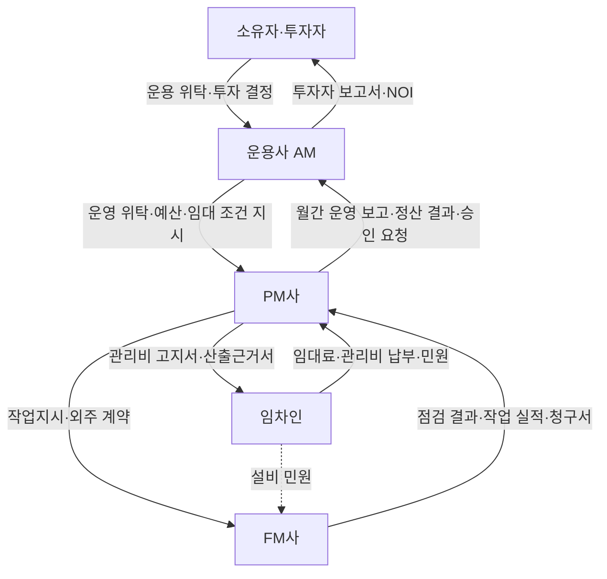
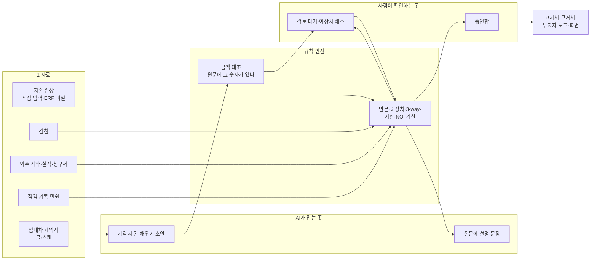

# PMAI(건물 관리 AI) 프로젝트 이해

> 기준일 2026-11-13 · 기준 프로그램 PM-AI(배포 https://pm-ai-woad.vercel.app/ , AM·PM·FM 메뉴 반영판) · 엔진 pmai-mvp를 함께 설명한다.
> 읽는 사람: 부동산 업계를 처음 접하는 사람, 이 문서로 교육 콘텐츠를 만들 사람.
> 문서 속 건물·회사·금액은 모두 앱에 들어 있는 가상 샘플이다.

---

## 1. 한 문장 요약

결론: **PMAI는 상업용 건물을 관리하는 회사가 매달 하는 계산·대조·기한 관리를 기계가 대신 해 주고, AI는 서류를 읽고 설명만 하며, 돈이 나가는 결정은 사람이 승인하게 만든 건물 관리 프로그램이다.**

- 누구의: 건물 주인 대신 건물을 굴리는 회사들(운용사·PM사·FM사)의 직원.
- 어떤 일을: 관리비 나누기, 임대차 만기 챙기기, 외주 청구서 검사, 법정점검 기한 관리, 건물 수익 보고.
- 어떻게 쉽게: 엑셀과 기억에 의존하던 일을 "규칙대로 계산 → 이상한 것만 사람에게 보여 주기 → 사람이 승인"으로 바꾼다.
- 비유: PMAI는 **계산기 + 비서 + 결재판**이 한 몸인 관리사무소다. 계산기는 어림잡지 않고, 비서(AI)는 서류를 읽어 주지만 숫자를 만들지 않으며, 결재판에 사인이 없으면 돈이 나가지 않는다.

---

## 2. 먼저 알아야 할 업무 지식: 상업용 건물은 어떻게 관리되나

결론: 오피스 빌딩·물류센터 같은 상업용 건물은 주인이 직접 관리하지 않고, **돈을 판단하는 회사(AM) · 임차인과 장부를 맡는 회사(PM) · 설비를 돌보는 회사(FM)**가 나눠 맡는다. 이 셋이 매달 보고서·고지서·작업지시·점검 결과를 주고받으며 건물이 돌아간다.

### 2-1. 등장하는 사람 다섯

**비유: 건물을 "식당 한 곳"으로 보면**
- 소유자·투자자 = 식당에 돈을 댄 **주주**
- 운용사(AM) = 주주를 대신해 "이 가게를 계속 할지, 값을 올릴지" 정하는 **사장**
- PM사 = 손님 응대와 계산대·장부를 맡은 **홀 매니저·경리**
- FM사 = 주방 설비·가스·전기를 챙기는 **설비 기사**
- 임차인 = 자리를 빌려 쓰는 **손님**(실제로는 사무실·매장을 빌린 회사)

| 등장인물 | 누구인가(실제 예) | 책임지는 것 | 성과를 재는 숫자 |
|---|---|---|---|
| 소유자·투자자 | 리츠(부동산 투자회사), 펀드, 법인, 개인. 샘플 A타워에는 리츠·펀드·법인·개인 5곳이 호실을 나눠 갖고 있다 | 돈을 대고 최종 결정(매입·매각·큰 공사)을 한다 | 배당, 자산 가치 |
| 운용사(AM, 자산관리) | 투자자 돈을 맡아 건물을 운용하는 회사 | 건물이 돈을 잘 벌게 하는 전략: 임대료 수준, 공실 채우기, 매각 시점, 큰 수선 투자 | NOI(순영업소득), 공실률, WALT(남은 임대 기간) |
| PM사(운영관리) | AM에게 위탁받아 건물 운영을 맡는 회사 | 임차인 계약 관리, 관리비 부과·정산, 수납·미수, 외주 관리, 월간 보고 | 수납률, 정산 정확도, 임차인 만족 |
| FM사(시설관리) | PM 아래 또는 직접 계약된 설비 관리 회사 | 승강기·소방·전기·냉난방 설비 운전, 법정점검, 고장 수리, 청소·경비 | 점검 기한 준수, 고장 처리 시간 |
| 임차인 | 사무실·매장·창고를 빌린 회사 | 임대료·관리비 납부, 계약 조건 지키기 | (임차인 입장) 비용, 서비스 품질 |

- 작은 건물에서는 PM과 FM을 한 회사가 같이 하거나, 소유자가 AM 역할을 직접 하기도 한다. 큰 건물일수록 셋이 분명히 나뉜다.
- 호실마다 주인이 다른 건물(집합건물)에는 **관리단**이 있다. 구분소유자(호실 주인)들의 모임으로, 집회를 열어 규약 변경·큰 공사를 표결한다.

### 2-2. 각자의 하루와 한 달

| | 매일 | 매달 | 매년·수시 |
|---|---|---|---|
| AM | 임대 문의·협상 진행 확인, 큰 민원·사고 보고 받기 | PM 월간 보고 검토, NOI 확인, 투자자 보고서 작성 | 예산 승인, 임대료 인상 협상, 재계약 전략, 매입·매각 실사 |
| PM | 민원 접수, 입금 확인, 외주 업체 작업 확인, 결재 | 관리비 계산·고지(보통 월초에 지난달 비용 정산), 미수 독촉, 외주 청구서 검토·지급, AM에 월간 보고 | 임대차 갱신·만기 통지, 예산 편성, 관리단 집회 준비 |
| FM | 설비 순회 점검, 고장 수리(작업지시 처리), 검침, 자재 출고 | 점검 일정 관리, 자재 발주, 작업 실적 정리(청구 근거) | 법정점검·검사 수검, 장기 수선 계획 |
| 임차인 | 민원 요청(냉난방, 누수 등) | 관리비 고지서 받고 납부 | 계약 갱신 협상 |

### 2-3. 서로 주고받는 것



| 서류·자료 | 누가 → 누구 | 무엇이 들어 있나 |
|---|---|---|
| 임대차 계약서 | 소유자(또는 AM) ↔ 임차인 | 보증금, 월 임대료, 기간, 인상 조건, 특약 |
| 렌트롤 | PM → AM | 호실별 임차인·보증금·임대료·만기를 한 표로 모은 목록 |
| 관리비 고지서·산출근거서 | PM → 임차인(소유자) | 이번 달 낼 관리비와 "왜 이 금액인지" 계산 근거 |
| 작업지시서 | PM(또는 민원) → FM | 어디서 무엇을 언제까지 고칠지 |
| 점검 결과·증빙 | FM → PM | 법정점검 실시일, 지적 사항, 조치 결과 |
| 외주 청구서(인보이스) | 청소·경비·승강기 업체 → PM | 이번 달 수행한 작업과 청구 금액 |
| 월간 운영 보고서 | PM → AM | 수납·미수, 비용, 공실, 사고·민원 |
| 투자자 보고서 | AM → 투자자 | NOI, 임대율, 만기 일정, 리스크 |

### 2-4. 일의 순서 ① 임대차 계약

결론: 계약서 한 장에 앞으로 몇 년 동안의 돈과 기한이 다 들어 있어서, 계약서를 정확히 옮겨 적는 것이 모든 일의 출발점이다.

- 흐름: 임대 문의 → 조건 협상(AM 판단) → 계약 체결 → 렌트롤 등록(PM) → 입주 → 매년 인상일 → 만기 몇 달 전 갱신 통지 → 재계약 또는 퇴거 → 공실.
- 실제 예(샘플 A타워 101호): 임차인 카페 모닝브루, 보증금 6,000만 원, 월 임대료 620만 원, 특약 "임대료 매년 7% 인상", 갱신 통지 6개월 전.
- **상가임대차보호법의 5% 상한**: 일정 규모 이하의 상가 임차인은 임대료를 한 번에 5%까지만 올릴 수 있다. 대상인지는 **환산보증금**(보증금 + 월세 × 100)으로 가른다.
  - 101호 환산보증금 = 6,000만 + 620만 × 100 = **6억 8,000만 원**.
  - 지역별 기준액(시행령으로 정함, 앱에는 서울 9억 원을 예시값으로 넣음) 이하이므로 계약서에 7%라고 써 있어도 **5%만 올릴 수 있다** → 620만 → 651만 원.
- **렌트프리**: 계약 초기 몇 달 임대료를 받지 않는 조건. 샘플의 글로벌컨설팅코리아는 3개월 렌트프리로 계약했다.
- 놓치면 생기는 일: 갱신 통지 기한을 지나면 협상 기회를 잃고, 인상일을 놓치면 그만큼 임대료를 덜 받는다.

### 2-5. 일의 순서 ② 관리비 부과·정산

결론: 관리비는 건물 전체에 든 돈을 호실마다 "정해진 기준"으로 나누는 일이고, 나눈 합이 원래 비용과 1원이라도 다르면 안 된다.

- 흐름: 지난달 비용 집계(청소·경비·전기·수도 등) → 검침(호실별 전기·수도 사용량) → 항목별 기준으로 나누기(**안분**) → 합계 맞추기(**대사**) → 고지서 발행 → 납부 → 미수 독촉.
- 나누는 기준의 실제 예(샘플 A타워 관리비 항목 12개 중):

| 항목 | 나누는 기준 |
|---|---|
| 청소·경비·시설관리 용역비, 승강기유지비 | 계약면적 비율 |
| 화재보험료 | 전용면적 비율 |
| 전용전기료, 수도료 | 호실 검침 사용량 |
| 공용전기료 | 계약면적 50% + 검침 사용량 50% 혼합 |
| 장기수선충당금 | 전용면적 비율, 소유자만 부담 |

- 예외가 계산을 어렵게 한다.
  - **공실**: 비어 있는 1601호의 몫은 소유자가 낸다.
  - **특약**: 넥스트핀테크(주)는 "수선유지비 월 150만 원 상한" 특약이 있어 넘는 부분은 소유자가 낸다. 스마트모빌리티(주)는 화재보험료를 내지 않는다.
  - **정액 관리비**: 한결세무법인은 관리비를 월 980만 원으로 고정했다(전용 사용료 별도).
- 면적 두 가지: **전용면적**은 그 호실만 쓰는 면적, **계약면적**은 전용면적에 복도·화장실 같은 공용 부분 몫을 더한 면적. 샘플 101호는 전용 420㎡, 계약 780㎡다.

### 2-6. 일의 순서 ③ 외주 관리와 법정점검

결론: 건물 비용의 상당 부분이 외주 용역이라 청구서를 계약·실적과 맞춰 보는 것이 곧 돈을 지키는 일이고, 법정점검은 놓치면 과태료가 나오는 기한 관리다.

- 외주 청구서 검사(**3-way 대조**): ① 계약서(약정 인원·단가) ② 작업 실적(실제 투입) ③ 청구서(청구 금액)를 맞댄다. 예: 청소 인원 12명 계약인데 14명분 청구, 같은 청구서가 두 번 들어옴.
- **법정점검**: 법이 정한 주기로 해야 하는 점검·검사. 소방시설, 승강기, 전기설비, 가스, 저수조, 보일러 등이 있고 주기는 설비마다 다르다. 결과로 지적 사항이 나오면 기한 안에 고쳐야 한다. 샘플 A타워에는 11종이 적용된다.
- **민원**: 임차인의 "회의실 냉난방기 소음" 같은 요청. 설비 문제면 작업지시가 되어 FM에게 간다.

### 2-7. 일의 순서 ④ 숫자로 건물 평가하기 (AM의 일)

결론: AM은 건물을 "한 달에 얼마 남기는 기계"로 보고, NOI·공실률·WALT 세 숫자로 판단한다.

| 숫자 | 뜻 | 샘플 A타워(2026-10 정산, 11/13 기준) |
|---|---|---|
| 월 실수령 임대료 | 임차인이 실제 내는 임대료 합계 | 4억 6,270만 원 |
| 소유자 부담 운영비 | 공실분·특약 초과분 등 소유자가 낸 비용(장기수선충당금 제외) | 4,637만 원 |
| **NOI**(순영업소득) | 실수령 임대료 − 소유자 부담 운영비 | **4억 1,633만 원** |
| 임대율 / 공실률 | 전체 계약면적 중 임대 중인 비율 / 빈 비율 | 82.6% / 17.4%(1601호 8,940㎡ 공실) |
| **WALT** | 남은 임대 기간 평균(임대료가 큰 임차인일수록 크게 반영) | 2.19년 |

- WALT가 짧으면 "곧 계약이 많이 끝난다"는 뜻이라 매각 가격과 대출 조건에 불리하다.
- 매입·매각 전에는 **실사**(재무·건물 상태·법률 위험을 조사하는 일)를 한다.

### 2-8. 대형 건물과 중소형 건물의 차이

- 대형 건물(운용사·대형 PM사): 회계·전표를 **ERP**(회사의 회계 시스템, 예: 더존·SAP)로 이미 관리한다. 필요한 것은 ERP 자료를 검사해 주는 도구다.
- 중소형 건물: ERP 없이 엑셀로 관리비를 계산하는 곳이 많다. 장부 자체가 필요하다.
- 그래서 PMAI는 **중소형은 PMAI가 장부를 직접 맡고, 대형은 기존 ERP와 연동해 검증만** 한다(11/13 확정).

---

## 3. 이 프로젝트가 푸는 문제

결론: 위 업무는 숫자·예외·기한이 많아 사람이 엑셀과 기억으로 처리하다 보니, 틀려도 모르고 기한을 놓치며 보고가 늦다. 손해는 곧 돈(과청구·인상 누락)과 법(과태료·분쟁)이다.

| 힘든 곳 | 지금 하는 방식 | 그래서 생기는 손해 |
|---|---|---|
| 관리비 안분 | 엑셀 수식, 공실·특약은 손으로 조정 | 합계 불일치, 임차인 이의 제기, 재고지 |
| 외주 청구서 | 담당자가 눈으로 확인 후 결재 | 인원 초과·중복 청구를 그대로 지급 |
| 임대차 기한 | 달력·메모, 담당자 기억 | 갱신 통지·인상일 누락, 5% 상한 위반 인상 → 분쟁 |
| 법정점검 | 업체 통보에 의존 | 기한 경과 → 과태료, 지적 사항 방치 |
| 오래된 계약서 | 스캔 이미지를 사람이 옮겨 적음 | 오타가 그대로 장부에 들어감 |
| 월간·투자자 보고 | 여러 엑셀을 손으로 합침 | 보고가 늦고, 숫자 근거를 되짚기 어렵다 |
| AI 도입 | 챗봇에 서류를 넣어 물어봄 | 그럴듯하게 틀린 숫자, 누가 책임지는지 불분명 |

- PMAI의 답: 계산은 **규칙 엔진**(같은 입력이면 항상 같은 결과를 내는 계산 프로그램)이 하고, 모든 금액에 계산 근거를 붙이고, AI는 읽기·설명만 하고, 돈·법·안전에 닿는 결정은 **승인함**을 거치게 한다.

---

## 4. 기능 전체

결론: 화면은 20개이고, 메뉴로는 **AM 7개 · PM 9개 · FM 8개 · 공통 2개, 모두 26개 항목**이다(대시보드·AI 비서·승인함은 여러 묶음에 같은 화면으로 들어 있다). 어떤 역할로 들어왔는지에 따라 보이는 묶음과 메뉴가 다르다.

### 4-1. 역할과 작업공간

- 화면 위쪽에서 **건물**(강남 A타워 / 이천 B물류센터)과 **역할**을 고른다. 역할은 운용사·PM사·FM사·임차인·소유자 다섯 가지다.
- 왼쪽 메뉴 위에 **작업공간 탭**(AM / PM / FM)이 있고, 역할에 따라 들어갈 수 있는 탭이 다르다.

| 역할 | 들어갈 수 있는 작업공간 | 보이는 메뉴 수(공통 2개 제외) |
|---|---|---|
| 운용사 | AM · PM · FM (AM 탭은 운용사에게만 보인다) | AM 7 · PM 9 · FM 8 |
| PM사 | PM · FM | PM 9 · FM 8 |
| FM사 | FM | FM 8 |
| 소유자 | PM | 대시보드, 관리비, 관리단, AI 비서 (4) |
| 임차인 | PM · FM | PM: 대시보드, 관리비, AI 비서 (3) · FM: 대시보드, 법정점검·민원 (2) |

- **승인 권한은 PM사와 운용사만** 있다. FM사는 승인함을 볼 수는 있지만 승인·반려 버튼이 막힌다.
- 지금 역할 전환은 시연용이다. 실제 로그인과 권한 검사는 아직 없다(8장).

### 4-2. 공통 화면 (여러 작업공간에 같이 들어 있음)

**대시보드** (AM·PM·FM 모두, 모든 역할)
- 누가·언제: 누구나, 아침에 가장 먼저.
- 넣는 것: 없음(건물만 고른다).
- 나오는 것: 임대율, 미수금, 외주 과청구 의심액, 정산 상태, "오늘 확인할 일", 180일 안의 임대차 일정, 최근 12개월 관리비 지출 그래프, 바로가기.
- 좋아지는 것: 흩어진 기한과 경고를 한 화면에서 본다.
- 주의: 요약일 뿐이고, 처리는 각 메뉴에서 한다.

**AI 판단 보조(AM) / AI 비서(PM·FM)** — 같은 화면이다.
- 누가·언제: 숫자나 상황을 말로 묻고 싶을 때. 예: "전기요금 줄일 방법은?"
- 넣는 것: 질문 한 줄.
- 나오는 것: 엔진이 계산해 둔 **사실 목록**에서 고른 근거와 설명.
- 좋아지는 것: 여러 화면을 뒤지지 않고 답을 얻는다.
- 주의: 조회·설명만 한다. 고지·지급·발주는 못 한다. AI 키가 없으면 사실 목록만 보여 준다.

**승인함** (AM·PM·FM, 직원 역할)
- 누가·언제: PM사·운용사 담당자가 결재할 때.
- 넣는 것: 승인 또는 반려(반려는 의견 필수).
- 나오는 것: 승인 대기 목록(관리비 고지, 외주 지급, 임대차 등록, 발주 네 종류), 금액, 요청자, "근거 화면 열기" 링크, 처리 이력.
- 좋아지는 것: 돈이 나가는 일은 모두 한 곳에서 사람이 확인한다.
- 주의: 승인 단계를 L0(초안)~L3(범위 내 자율)로 나누며, 고지·지급·발주는 L2(자동으로 만들되 승인 필수)를 넘지 않는다.

### 4-3. AM 자산관리 — 판단·전략 (운용사 전용)

**포트폴리오·NOI**
- 누가·언제: AM, 매달 정산 뒤.
- 나오는 것: 건물별·전체 월 실수령 임대료, 월 NOI, 임대율(면적 기준), WALT(임대료 가중).
- 예: 두 건물 합계 월 NOI 6억 7,977만 원, 임대율 81.3%, WALT 1.83년(11/13 기준).
- 좋아지는 것: 투자 판단 숫자를 손으로 합치지 않는다.
- 주의: NOI는 이 앱의 정의(실수령 임대료 − 소유자 부담 운영비, 장기수선충당금 제외)를 따른다. 회사마다 정의가 다를 수 있다.

**임대 전략**
- 누가·언제: AM, 재계약·임대료 협상 전.
- 나오는 것: 만기 분포(해마다 몇 %의 임대료가 끝나는지), 1년 안에 만기가 오는 임대료, 평균 임대료 단가, 임차인별 단가·만기, 공실 호실과 공실이 소유자에게 매달 지우는 비용.
- 예: 카페 모닝브루·한결세무법인은 "단가가 평균보다 낮음 — 인상 협상 여지", 퍼스트증권은 "인상률 협의 조항".
- 주의: 평균 대비 ±15%를 넘으면 표시하는 단순 규칙이다. 시장 시세와 비교하지는 않는다.

**투자자 보고**
- 누가·언제: AM, 월말·분기말.
- 나오는 것: 자산별 월간 운영 보고 초안(요약, 임대 현황, 운영·비용, 리스크, 앞으로 60일 일정). 인쇄·PDF 저장.
- 좋아지는 것: 보고서 초안 작성 시간이 줄고, 숫자가 장부와 같다.
- 주의: 숫자는 엔진이, 문장은 규칙이 만든다. 대외 발송 전 담당 AM이 확인·승인해야 한다.

**실사 리스크 (DDR)**
- 누가·언제: AM, 건물 매입·매각 검토 때.
- 넣는 것: 재무(손익·렌트롤·예산), 물리(건물 상태 보고서·설비 이력), 법률·임대차 세 칸에 파일.
- 나오는 것: 정규화 NOI, WALT·임차인 집중도, 물리 등급·즉시 수선비, 법률 위험 표시, 위험 지도와 위험 목록. 인쇄·PDF.
- 주의: **지금은 파일 본문을 읽지 않고 파일 이름만 AI에 넘겨 가정 기반 시뮬레이션을 만든다.** 실제 투자 판단에 쓰면 안 된다. 부가 서비스 화면에서도 이 화면으로 들어간다.

**AI 판단 보조 · 승인함**: 4-2 공통 화면과 같다.

### 4-4. PM 임대·운영 — 정산·계약

**관리비**
- 누가·언제: PM, 매달 초. 임차인·소유자는 자기 몫만 열람한다.
- 넣는 것: 정산 월을 고르고 "정산 실행". 지출 원장·검침·임대차 조건을 자동으로 가져온다.
- 나오는 것: 지출 합계, 임차인 부담, 소유자 부담, **대사 차이**(지출 합계 − 나눈 합계), 미해소 이상치. 탭은 호실별 결과 · 항목별 공개 내역 · 이상치 · 고지서·산출근거서.
- 예: A타워 10월 지출 2억 8,146만 원 → 대사 차이 0원. 이상치 5건(중복 청구 1, 계정 오분류 1, 전년 대비 급증 3).
- 좋아지는 것: 공실·특약·정액 관리비가 자동 반영되고, 금액마다 계산 근거가 남는다.
- 주의: 위험도 높은 이상치를 해소(확인 결과 메모 입력)해야 "고지 확정 승인 요청"을 보낼 수 있다. 고지서 양식의 법정 서식 적합 여부는 법무 검토 전이다.

**임대차**
- 누가·언제: PM(운용사도), 계약 등록·만기 관리 때.
- 탭: **렌트롤**(활성 계약, 월 임대료 합계, WALT) · **이벤트 캘린더**(만기·갱신 통지·인상·렌트프리 종료, 90일 안 이벤트) · **계약서 추출**.
- 계약서 추출: 계약서 글을 붙여 넣으면 임차인·보증금·임대료·기간·인상 조항·특약을 칸에 채운 **초안(L0)**이 나온다. 공실 호실을 골라 "검토 큐에 등록" → 사람이 "검토 완료".
- 예: 카페 모닝브루 인상 판정 — 7% 조항이지만 환산보증금 6.8억 원으로 5%만 적용, 620만 → 651만 원.
- 주의: 환산보증금 기준액·상한은 예시값이다. AI 키가 없으면 정형 문구만 읽는 규칙 추출로 바뀌어 신뢰도가 낮다.

**관리단**
- 누가·언제: PM·운용사·소유자, 관리단집회 준비와 표결 때.
- 탭: 집회·안건(찬성·반대·기권, "현재 가결 요건 충족" 판정, 표결 마감) · 구분소유자·의결권 · 관리비 공개.
- 예: 임시 관리단집회 안건 2건(주차장 규약 변경, 승강기 교체).
- 주의: 정족수는 집합건물법 일반 기준을 따른 예시다. 규약이 다르게 정하면 규약이 우선할 수 있다.

**회계**
- 누가·언제: PM, 매일 입금 확인과 지출 등록.
- 탭: 지출 원장(거래처·계정·금액 등록) · 수납·미수(고지액, 연체, "수납 확인") · 예산 대비 실적.
- 예: 미수 857만 원(카페 모닝브루 2개월 연체).
- 주의: 고지액은 승인된 정산에서 자동으로 생긴다. 은행 거래내역 연동이 없어 입금은 사람이 확인하고 누른다. 예산은 전년 실적의 103%로 만든 샘플이다. 화면 안내 문구가 아직 "ERP를 대체하지 않는다"는 예전 방향으로 적혀 있다.

**법무**
- 누가·언제: PM, 분쟁·자문이 생겼을 때.
- 탭: 사례(제목·상대방·쟁점·다툼 금액·사실관계 등록) · 법령·판례 검색(국가법령정보 공개 서비스) · 쟁점별 기준 조문. 사례에서 "법무 검토 메모 초안(L0)"을 만든다.
- 예: "임대료 인상률 이의" 사례가 임대차의 5% 판정과 연결된다.
- 주의: 법률 자문이 아니다. 판례는 검색 결과만 보여 주고 지어내지 않는다. 검색을 쓰려면 설정에 국가법령정보 사용자 ID를 넣어야 한다.

**AI 비서 · 승인함**: 4-2와 같다.

**감사 로그**
- 누가·언제: PM·운용사, 문제가 생겨 되짚을 때.
- 나오는 것: 시각, 사용자·역할, 행위(정산 실행·승인·발주 등), 대상, 내용, 규칙·모델 버전, **입력 해시**(계산에 쓴 자료의 지문).
- 좋아지는 것: "이 고지서는 누가, 어떤 자료와 규칙으로 만들었나"를 증명할 수 있다.

### 4-5. FM 시설 — 현장·설비

**설비 이력·작업지시**
- 누가·언제: FM, 매일 아침 작업 배정.
- 나오는 것: 설비 대장(승강기·소방·수변전·보일러 등마다 마지막 점검일·다음 기한·미조치 지적), 작업지시 목록(점검 지적 + 시설 민원), 열린 작업, 기한 지난 작업.
- 예: "지하 2층 스프링클러 헤드 도장 오염"(점검 지적, 기한 지남), "4층 회의실 냉난방기 소음"(민원 → 글 속 '냉난방'을 보고 공조 설비로 **(추정)** 표시).
- 주의: 점검 지적의 시정 기한은 일괄 "점검일 + 1개월"(예시)이다.

**법정점검·민원** (화면 제목은 "행정")
- 누가·언제: FM·PM은 점검 관리, 임차인은 민원 접수.
- 탭: 법정점검 캘린더(완료·기한 경과·30일 이내) · 민원(접수·대장) · 적용 룰셋. 임차인에게는 민원 탭만 보인다.
- 넣는 것: 점검 완료 시 **증빙**(필수). 완료하면 다음 회차가 주기에 맞춰 자동으로 생긴다.
- 예: A타워 적용 점검 11종, 기한 경과 1건, 30일 이내 2건.
- 주의: 건물 용도·규모·설비로 적용 점검을 자동으로 고르지만, 주기와 대상 기준은 예시값이다.

**외주계약**
- 누가·언제: PM·FM, 매달 외주 청구서가 들어올 때.
- 탭: 인보이스 검증(3-way 대조, 지급 적정액, 과청구 의심) · 계약 · 벤더 스코어카드(최근 6개월).
- 예: A타워 10월 청구서 5건 중 3건 지적, 과청구 의심 **2,112만 원**(청소 미수행분 1,050만, 경비 단가 불일치·계약 외 항목 402만, 승강기 중복 청구 660만).
- 주의: 지급 적정액 = 청구·실적·계약 수량 중 가장 작은 값 × 계약 단가. 실제 송금은 ERP·은행에서 사람이 한다. 업체 점수 산식(SLA 준수 50 + 청구 정확도 40 + 기본 10 − 사고 감점)은 계약에 맞게 조정해야 한다.

**수발주·재고**
- 누가·언제: FM, 자재가 떨어지기 전.
- 탭: 재고 현황(출고 입력) · 발주 제안(L1) · 발주서(입고 처리) · 입출고 이력.
- 예: LED 평판등 14개가 재주문점 25개(안전재고 20 + 월 출고 9 × 0.5개월) 이하 → 24개 발주 제안.
- 주의: 제안은 최근 3개월 출고 실적으로 계산한다. 발주서는 승인함 승인 뒤에야 입고 처리된다.

**수광열비** (전기·가스·수도 비용)
- 탭: 사용·요금 추이 · 전기요금 시나리오(15분 최대수요전력, 계약전력 비교) · 호실 검침 · 탄소·ESG(배출량, 감축 경로 대비). 자산 데이터 CSV 내보내기.
- 좋아지는 것: 검침값이 그대로 관리비 안분 기준이 되고, 계약전력·요금제 변경 효과를 미리 본다.
- 주의: 요금 단가·배출계수는 예시값이다. 실제 결정 전 한전 요금표와 15분 데이터로 바꿔야 한다.

**AI 비서 · 승인함**: 4-2와 같다.

### 4-6. 모든 작업공간 아래 공통 메뉴

**부가 서비스**: 함께 쓰는 서비스 안내 카드 6개 — RUNIQ STUDIO(인테리어), PMAI Academy(교육), 한판오피스(문서), QR 주차, AI 콜센터(민원 1차 응대 → 민원 대장), 실사 리스크 분석(앱 안 화면으로 연결). 외부 링크는 설정에서 넣는다.

**설정**: 사용자 이름(감사 로그에 기록), AI 연결(Claude / Gemini / 사용 안 함), 국가법령정보 사용자 ID, 부가 서비스 링크, "샘플 데이터로 초기화". 모든 값은 그 브라우저에만 저장된다.

---

## 5. 하루 따라가기

결론: PM 담당자는 아침 대시보드 → 관리비 정산 → 이상치 해소 → 승인 요청 → 외주 청구서 검사 → 미수 확인 순서로 하루를 보내고, 그 사이 AM과 FM은 각자 화면에서 같은 숫자를 받아 쓴다. 숫자는 샘플 A타워, 2026-10 정산분(11/13 기준)이다.

### 5-1. PM 담당자의 하루 (역할: PM사, 건물: 강남 A타워)

| 시각 | 하는 일 | 화면 | 무엇이 보이나 / 무엇을 하나 |
|---|---|---|---|
| 09:00 | 오늘 할 일 확인 | 대시보드 | "오늘 확인할 일"에 메디케어바이오 만기(2027-01-01, D-49)와 기한 지난 법정점검 1건 |
| 09:15 | 만기 대응 확인 | 임대차 › 이벤트 캘린더 | 메디케어바이오 갱신 통지 기한(3개월 전)이 임박. AM에 재계약 의향 확인 요청 |
| 09:30 | 10월 관리비 계산 | 관리비 › 정산 실행 | 지출 2억 8,146만 원을 12개 항목·8개 호실로 나눔. 대사 차이 0원. 1601호 공실분과 넥스트핀테크 수선비 150만 원 초과분은 소유자 부담으로 자동 이동 |
| 09:40 | 이상치 5건 검토 | 관리비 › 이상치 | 승강기 중복 청구 1건 → "거래처 확인 — 중복분 취소 요청" 메모 입력해 해소. 소모품 계정 오분류 1건, 전년 대비 급증 3건도 사유 기록 |
| 10:10 | 고지 승인 요청 | 관리비 › 고지 확정 승인 요청 | 고위험 이상치가 모두 풀려야 버튼이 동작. 승인함에 "관리비 고지" 건이 올라감 |
| 10:20 | 고지서 확인 | 관리비 › 고지서·산출근거서 | 호실별 고지서와 "어느 기준으로 얼마"가 적힌 근거서. 인쇄·PDF |
| 11:00 | 외주 청구서 검사 | 외주계약 › 인보이스 검증 | 10월 청구서 5건 중 3건 지적, 과청구 의심 2,112만 원. 청소 업체에 미수행분 1,050만 원 소명 요청, 적정액만 지급 요청 |
| 14:00 | 미수 독촉 | 회계 › 수납·미수 | 미수 857만 원, 카페 모닝브루 2개월 연체. 오늘 들어온 다른 임차인 입금은 "수납 확인" |
| 14:30 | 인상 이의 대응 | 법무 › 사례 | 카페 모닝브루 "임대료 인상률 이의" 사례. 5% 상한 판정(620만 → 651만 원)을 근거로 검토 메모 초안 작성 |
| 16:00 | 결재 | 승인함 | 운용사 결재자가 관리비 고지 건 승인 → 회계 수납 목록에 고지액이 자동으로 생김 |
| 17:30 | 하루 기록 확인 | 감사 로그 | 정산 실행·이상치 해소·승인 요청·승인이 시각·사람·입력 해시와 함께 남음 |

- 엑셀이었다면: 안분 수식 확인, 공실·특약 수작업 조정, 청구서 대조에 반나절 이상이 들고, 중복 청구는 눈에 띄지 않으면 그대로 지급된다.

### 5-2. AM 장면: 월말 투자자 보고 (역할: 운용사)

1. 포트폴리오·NOI에서 A타워 월 NOI 4억 1,633만 원(실수령 임대료 4억 6,270만 − 소유자 부담 4,637만), 임대율 82.6%, WALT 2.19년을 본다.
2. 임대 전략에서 1601호(16~18층, 계약면적 8,940㎡) 공실이 소유자에게 매달 지우는 비용과, 단가가 평균보다 낮은 카페 모닝브루·한결세무법인을 확인한다.
3. 투자자 보고 화면에서 초안을 열어 리스크 문장(공실, 메디케어바이오 만기)을 확인하고 PDF로 저장한다.

### 5-3. FM 장면: 아침 작업 배정 (역할: FM사)

1. 설비 이력·작업지시에서 열린 작업 2건을 본다: 지하 2층 스프링클러 헤드 도장 오염(기한 지남), 4층 회의실 냉난방기 소음(공조 설비 추정).
2. 스프링클러 건을 먼저 조치하고, 법정점검·민원 화면에서 증빙을 넣어 완료 처리한다.
3. 수발주·재고에서 LED 평판등 14개(재주문점 25개 이하)를 보고 24개 발주서를 만든다 → 승인함으로 올라가 PM사 승인 뒤 입고 처리.

---

## 6. 어떻게 돌아가나

결론: 자료가 들어오면 규칙 엔진이 계산·검증하고, 사람이 확인·승인한 뒤 화면과 서류로 나간다. AI는 들어오는 쪽(서류 읽기)과 나가는 쪽(설명 문장)에만 붙는다.



| 단계 | 누가 | 하는 일 |
|---|---|---|
| 서류 읽기 | AI | 계약서에서 보증금·임대료·만기를 뽑아 **초안**으로 채움 |
| 금액 대조 | 엔진 | 뽑은 숫자가 원문에 실제로 있는지, 한글 금액("금 오천만원정")과 숫자가 같은지 확인. 다르면 "검토 대기" |
| 계산 | 엔진 | 안분, 이상치, 3-way, 5% 상한, 기한, NOI. 같은 입력이면 항상 같은 결과 |
| 확인 | 사람 | 초안 확정, 이상치 해소 사유 기록 |
| 승인 | 사람 | 고지·지급·임대차 등록·발주 결재 |
| 설명 | AI | 엔진이 만든 사실 목록만 보고 답함 |
| 기록 | 엔진 | 모든 행위를 감사 로그로 남김 |

- 엔진 쪽 부품(pmai-mvp)에는 스캔 계약서 판독, 금액 대조, **사람이 고친 값 기록**(AI 원래 값과 사람이 확정한 값을 칸별로 비교해 실제 오답률을 내고 나중에 학습 자료로 씀), **법률 브리프**(법령과 과거 운영 사례를 찾아 붙인 검토 자료), 사내 AI 모델 Ten OS 연결이 이미 있다. 이것을 PM-AI로 옮기는 중이다.

---

## 7. 왜 이렇게 만들었나

결론: 모든 답은 "AI를 믿게 하지 말고, 검증 구조를 믿게 만든다"로 모인다.

**Q. AI가 숫자를 틀리면?**
- AI는 금액을 계산하지 않는다(확정). 관리비·NOI·과청구액은 전부 규칙 엔진이 계산한다.
- AI가 읽은 계약서 값은 초안이다. 원문에 없는 숫자이거나 한글·숫자 금액이 다르면 자동으로 검토 대기가 되고, 기계가 값을 고쳐 넣지 않는다.
- AI가 문장을 다듬다 숫자를 바꾸면 원래 문장을 쓴다(pmai-mvp에 구현).

**Q. AI 연결이 끊기거나 키가 없으면?**
- 규칙 기반 추출과 사실 목록으로 그대로 돌아간다. 계산 기능은 AI와 상관없다.

**Q. 왜 승인을 꼭 사람이 하나? 자동으로 보내면 더 빠르지 않나?**
- 고지·지급·발주는 돈·법에 닿는다. 틀렸을 때 책임질 사람이 있어야 하므로 L2(자동 생성, 승인 필수)를 넘지 않게 막았다.

**Q. 왜 ERP를 통째로 대신하지 않나?**
- 대형 건물은 이미 ERP에 장부가 있고 바꾸기 어렵다. 그래서 ERP 자료를 받아 검증만 한다. ERP가 없는 중소형 건물은 PMAI가 장부를 직접 맡는다(11/13 확정).

**Q. 고객 자료가 밖으로 나가면 안 되는 곳은?**
- 두 가지 판으로 간다(11/12 방향 확정, 구현은 일부). **설치형**은 고객사 내부 서버에 설치하고 사내 모델 Ten OS를 쓴다. **클라우드형**은 우리 서버에서 제공하고 외부 대형 AI를 쓴다. 같은 프로그램에 AI 연결만 바꿔 끼우는 구조다.

**Q. 왜 메뉴를 AM·PM·FM으로 나눴나?**
- 세 직무가 보는 숫자와 하는 일이 달라서, 한 화면에 다 두면 각자 필요 없는 메뉴가 너무 많다. 2장의 업무 구분을 그대로 메뉴로 옮겼다.

**Q. 법정점검 주기나 기준액이 바뀌면?**
- 건물마다·법령마다 다른 값은 코드가 아니라 설정값(규칙표)에 버전을 붙여 둔다. 값을 바꾸면 감사 로그에 어떤 버전으로 계산했는지 남는다.

---

## 8. 현재 상태

결론: 화면 20개와 계산 엔진은 샘플 데이터로 모두 동작하고 테스트로 고정돼 있다. 스캔 계약서 판독은 실제 20건에서 88%를 측정했다. 실제 고객 건물 자료로는 아직 돌려 보지 않았다.

### 8-1. 되는 것

| 항목 | 상태 | 측정일·조건 |
|---|---|---|
| PM-AI 엔진 테스트 | 30개 모두 통과(안분 1원 일치, 공실·특약, 이상치, 5% 상한, 3-way, NOI, 점검 묶음, 작업지시) | 11/13 실행 |
| pmai-mvp 테스트 | 157개 중 156 통과, 1 건너뜀 | 11/13 실행 |
| 스캔 계약서 판독(pmai-mvp) | 정답률 88%(138칸 중 122칸), 보증금·월 임대료 20건 모두 정답, 지어낸 값 0건 | 11/12~11/13, 실제 스캔 계약서 20건(2010~2016년), 금액은 1원까지 맞아야 정답, 정답표는 사람 검수 전 |
| 배포 | https://pm-ai-woad.vercel.app/ 정상 응답 | 11/13 확인, 가상 데이터 |

- 판독 방식: 일반 글자 인식(Tesseract, 무료 공개 프로그램)으로 먼저 읽고, 의심되면 사내 모델로 다시 읽는다. 20건 중 11건이 사내 모델까지 갔다.
- 샘플 규모: 건물 2동(A타워 오피스 32,000㎡ 18층, B물류센터 54,000㎡), 호실 13개, 임대차 11건(공실 2), 관리비 항목 12개, 24개월 지출 원장 555건, 검침 624건, 외주 계약 5건·청구서 31건, 법정점검 회차 38건, 민원 4건, 재고 9품목. 검증 기능을 보여 주려고 일부러 넣은 오류(중복 청구, 계정 오분류, 인원 초과 청구 등)가 있다. 날짜는 앱을 처음 연 날 기준으로 만들어진다.

### 8-2. 아직 안 되는 것

- 서버가 없다. 데이터가 각자 브라우저에 저장돼 직원끼리 공유되지 않고, 로그인·권한 검사가 없다(역할 전환은 시연용).
- AI 키가 브라우저에 저장되고 브라우저에서 외부 AI로 직접 나간다.
- 스캔 판독·금액 대조·사람이 고친 값 기록·ERP 파일 받기·Ten OS 연결은 pmai-mvp에만 있다.
- 중소형 장부 중 고지서 발송 관리, 입금 대조, 연체료 계산, 월 마감, 전표 내보내기가 없다.
- 실사 리스크는 파일 이름만 보고 만드는 시뮬레이션이다.
- 점검 주기, 환산보증금 기준액, 전기요금표, 배출계수, 관리단 정족수는 예시값이다.

---

## 9. 한계와 남은 일

결론: 지금 PM-AI는 "잘 보이는 시연판"이다. 11/20 파일럿에서 실제 건물 자료를 넣으려면 코드 밖의 일(파일럿 건물·자료·동의)과 서버·판독 이식이 함께 끝나야 한다. 담당·기한은 제안이며 확정이 필요하다.

| # | 할 일 | 파일럿 전 필수 | 담당(제안) | 기한(제안) |
|---|---|---|---|---|
| 1 | 파일럿 건물과 범위 확정(몇 동, 어떤 메뉴, 성공 기준) | 필수 | 이사 → 대표 확인 | 11/14 |
| 2 | 파일럿 건물 실제 자료 받기(계약서 스캔, 관리비 집계표, ERP 원장, 점검 기록) | 필수 | 이사(현장 연결) | 11/17 |
| 3 | 자료 반출 동의·보안 조건 정리(클라우드형이면 외부 AI 사용 동의) | 필수 | 대표·이사 | 11/17 |
| 4 | PM-AI에 서버·로그인 붙이기(pmai-mvp 서버 재사용) | 필수 | 엔지니어 | 11/19 |
| 5 | 판독 파이프라인·금액 대조·수정 기록 옮기기 | 필수 | 엔지니어 | 11/19 |
| 6 | ERP 원장 파일 받기(더존 형식) 옮기기 | 대형 건물이면 필수 | 엔지니어 | 11/19 |
| 7 | 회계 화면 문구를 새 ERP 범위에 맞게 수정 | 필수 | 엔지니어 | 11/18 |
| 8 | 판독 정답표 사람 검수 | 권장 | 현업 담당(이사 지정) | 11/19 |
| 9 | 중소형 장부 나머지(고지·입금 대조·연체료·월 마감·전표 내보내기) | 파일럿 이후 | 엔지니어 | 범위 확정 후 |
| 10 | 예시값을 현행 법령·고시값으로 교체, 법무 검수 | 외부 제시 전 필수 | 이사 + 외부 법무 | 미정 |
| 11 | 설치형·클라우드형 두 판 포장(설치 절차, AI 연결 전환) | 파일럿 이후 | 엔지니어 | 미정 |
| 12 | 메뉴 배치 초안 확인 | 권장 | 이사 | 11/18 |
| 13 | 실사 리스크를 파일 본문 읽기로 바꾸기 | 파일럿 이후 | 엔지니어 | 미정 |

- 1~3번이 늦으면 4~6번을 끝내도 파일럿을 시작할 수 없다.

---

## 10. 30초 요약

- 상업용 건물은 **AM(돈 판단) · PM(임차인·장부) · FM(설비)**이 나눠 관리하고, 매달 관리비·청구서·점검·보고를 주고받는다.
- PMAI는 그 일을 **계산은 엔진, 설명은 AI, 판단은 사람** 원칙으로 한 프로그램에 묶었다. 화면 20개, 메뉴 26개 항목.
- 샘플 A타워 10월: 관리비 2억 8,146만 원을 1원 오차 없이 나눴고, 이상치 5건, 외주 과청구 의심 2,112만 원, 월 NOI 4억 1,633만 원.
- 실제 스캔 계약서 20건 판독 88%, 보증금·임대료는 20건 모두 정답, 지어낸 값 0건(11/12~13).
- ERP: 중소형은 PMAI가 장부를 직접, 대형은 기존 ERP 연동·검증만.
- 남은 핵심: 11/20 파일럿 전에 파일럿 건물·자료·동의를 확정하고, 서버·로그인과 판독 기능을 옮겨 붙이는 것.

## 용어 풀이

| 용어 | 뜻 |
|---|---|
| AM(자산관리) | 투자자를 대신해 건물이 돈을 잘 벌게 하는 전략을 맡는 일. 맡는 회사는 운용사 |
| PM(운영관리) | 임차인 계약·관리비·수납·외주 등 건물 운영을 맡는 일 |
| FM(시설관리) | 설비 운전·점검·수리·청소·경비를 맡는 일 |
| 리츠 | 여러 사람의 돈을 모아 부동산에 투자하는 회사 |
| 임차인 / 임대인 | 빌려 쓰는 쪽 / 빌려주는 쪽(소유자) |
| 렌트롤 | 호실별 임차인·보증금·임대료·만기를 한 표로 모은 목록 |
| 렌트프리 | 계약 초기 몇 달 임대료를 받지 않는 조건 |
| 특약 | 계약서에 따로 적은 조건(예: 수선비 월 150만 원 상한) |
| 환산보증금 | 보증금 + 월세 × 100. 상가임대차보호법 보호 대상인지 가르는 기준 |
| 5% 상한 | 보호 대상 상가는 임대료를 한 번에 5%까지만 올릴 수 있다는 규정 |
| 전용면적 / 계약면적 | 그 호실만 쓰는 면적 / 공용 부분 몫을 더한 면적 |
| 안분 | 건물 전체 비용을 호실별로 기준에 따라 나누는 것 |
| 대사 | 나눈 금액 합계가 원래 비용과 맞는지 맞춰 보는 것 |
| 이상치 | 평소와 크게 다르거나(급증) 중복·오분류가 의심되는 지출 |
| 장기수선충당금 | 큰 수선에 대비해 소유자가 미리 쌓는 돈 |
| 3-way 대조 | 계약·작업 실적·청구서 세 가지를 맞대 과청구를 찾는 방법 |
| SLA | 외주 업체가 약속한 서비스 수준(예: 출동 시간) |
| 법정점검 | 법이 정한 주기로 꼭 해야 하는 설비 점검·검사 |
| 작업지시 | 어디서 무엇을 언제까지 고칠지 FM에게 내리는 지시 |
| 관리단 / 집합건물 / 구분소유자 | 호실마다 주인이 다른 건물(집합건물)의 호실 주인(구분소유자) 모임 |
| 정족수 | 안건이 통과되려면 필요한 최소 참석·찬성 비율 |
| NOI(순영업소득) | 들어온 임대료에서 소유자가 낸 운영비를 뺀 돈 |
| 임대율 / 공실률 | 임대 중인 면적 비율 / 빈 면적 비율. 더하면 100% |
| WALT | 남은 임대 기간의 평균. 임대료가 큰 임차인일수록 크게 반영 |
| 실사 | 건물을 사고팔기 전 재무·건물 상태·법률 위험을 조사하는 일 |
| ERP | 회사의 회계·전표 시스템(더존, SAP 등) |
| 규칙 엔진 | 정해진 규칙대로만 계산해, 같은 입력이면 항상 같은 결과를 내는 프로그램 |
| 승인 단계(L0~L3) | L0 초안(사람이 전부 검토) · L1 제안 · L2 자동 생성 후 승인 필수 · L3 범위 내 자율 |
| 감사 로그 / 입력 해시 | 누가 언제 무엇을 했는지 남긴 기록 / 계산에 쓴 자료의 지문(자료가 바뀌면 값도 바뀜) |
| 글자 인식(OCR) | 스캔 이미지 속 글자를 텍스트로 바꾸는 기술 |
| Ten OS | 회사가 튜닝한 사내 AI 모델. 고객사 내부망 안에서 돌릴 수 있다 |
| 설치형 / 클라우드형 | 고객사 내부 서버에 설치 / 우리 서버에서 인터넷으로 제공 |
| 어댑터 | AI 회사를 바꿔 끼울 수 있게 만든 연결 부품 |

---

## 부록: 개발자용

### A. 메뉴 목록 대조표

기준: `src/components/nav.ts`(WORKSPACES, COMMON), `src/App.tsx`(라우트). 메뉴 26개 항목, 고유 라우트 20개(그 밖의 주소는 `/`로 돌려보냄). 표시 역할의 "전체"는 그 작업공간에 들어갈 수 있는 모든 역할이다.

| # | 작업공간 | 메뉴 이름 | 라우트 | 화면 파일 | 표시 역할 | 이 문서 |
|---|---|---|---|---|---|---|
| 1 | AM | 대시보드 | `/` | pages/Dashboard.tsx | 전체 | 4-2 |
| 2 | AM | 포트폴리오·NOI | `/am/portfolio` | pages/am/Portfolio.tsx | 운용사 | 4-3 |
| 3 | AM | 임대 전략 | `/am/leasing` | pages/am/Leasing.tsx | 운용사 | 4-3 |
| 4 | AM | 투자자 보고 | `/am/report` | pages/am/InvestorReport.tsx | 운용사 | 4-3 |
| 5 | AM | 실사 리스크 | `/due-diligence` | pages/DueDiligence.tsx | 운용사 | 4-3 |
| 6 | AM | AI 판단 보조 | `/ask` | pages/Ask.tsx | 운용사 | 4-2 |
| 7 | AM | 승인함 | `/approvals` | pages/Approvals.tsx | 운용사 | 4-2 |
| 8 | PM | 대시보드 | `/` | pages/Dashboard.tsx | 전체 | 4-2 |
| 9 | PM | 관리비 | `/charges` | pages/Charges.tsx | 전체 | 4-4 |
| 10 | PM | 임대차 | `/leases` | pages/Leases.tsx | 운용사·PM사 | 4-4 |
| 11 | PM | 관리단 | `/association` | pages/Association.tsx | 운용사·PM사·소유자 | 4-4 |
| 12 | PM | 회계 | `/accounting` | pages/Accounting.tsx | 운용사·PM사 | 4-4 |
| 13 | PM | 법무 | `/legal` | pages/Legal.tsx | 운용사·PM사 | 4-4 |
| 14 | PM | AI 비서 | `/ask` | pages/Ask.tsx | 전체 | 4-2 |
| 15 | PM | 승인함 | `/approvals` | pages/Approvals.tsx | 운용사·PM사 | 4-2 |
| 16 | PM | 감사 로그 | `/audit` | pages/AuditLog.tsx | 운용사·PM사 | 4-4 |
| 17 | FM | 대시보드 | `/` | pages/Dashboard.tsx | 전체 | 4-2 |
| 18 | FM | 설비 이력·작업지시 | `/fm/assets` | pages/fm/Assets.tsx | 운용사·PM사·FM사 | 4-5 |
| 19 | FM | 법정점검·민원 | `/admin` | pages/Admin.tsx | 운용사·PM사·FM사·임차인 | 4-5 |
| 20 | FM | 외주계약 | `/vendors` | pages/Vendors.tsx | 운용사·PM사·FM사 | 4-5 |
| 21 | FM | 수발주·재고 | `/inventory` | pages/Inventory.tsx | 운용사·PM사·FM사 | 4-5 |
| 22 | FM | 수광열비 | `/utilities` | pages/Utilities.tsx | 운용사·PM사·FM사 | 4-5 |
| 23 | FM | AI 비서 | `/ask` | pages/Ask.tsx | 운용사·PM사·FM사 | 4-2 |
| 24 | FM | 승인함 | `/approvals` | pages/Approvals.tsx | 운용사·PM사·FM사(FM사는 승인 불가) | 4-2 |
| 25 | 공통 | 부가 서비스 | `/services` | pages/Services.tsx | 전체 | 4-6 |
| 26 | 공통 | 설정 | `/settings` | pages/Settings.tsx | 전체 | 4-6 |

- 라우트 20개가 모두 메뉴에 있다: `/`, `/am/portfolio`, `/am/leasing`, `/am/report`, `/fm/assets`, `/charges`, `/leases`, `/utilities`, `/association`, `/admin`, `/legal`, `/vendors`, `/accounting`, `/inventory`, `/ask`, `/approvals`, `/audit`, `/services`, `/due-diligence`, `/settings`. 메뉴 없는 라우트는 없다.
- 역할별 작업공간: `ROLE_WORKSPACES` = 운용사 am·pm·fm / PM사 pm·fm / FM사 fm / 소유자 pm / 임차인 pm·fm. 승인 권한 `canApprove` = PM사·운용사.
- 화면 안 역할 분기: 관리비는 임차인·소유자에게 자기 몫만, 이상치 탭은 직원만. 법정점검·민원은 임차인에게 민원 탭만.

### B. 기술 구성

| | PM-AI(기준 제품) | pmai-mvp(엔진 원천) |
|---|---|---|
| 화면 | React 19 + Vite 6 + TypeScript + Tailwind 4, 상태 zustand(localStorage) | React 18 단일 HTML(`web/index.template.html` → `build_demo.py`) |
| 서버 | 없음(Vercel 정적 배포, `/lawapi` → law.go.kr 중계) | FastAPI + SQLAlchemy 2 + Alembic, SQLite(개발)/PostgreSQL(운영) |
| AI | `src/llm/adapter.ts`(Claude·Gemini, 규칙 대체) | `server/app/llm/adapter.py`(mock/anthropic/tenos, 숫자 변경 차단) |
| 테스트 | vitest `src/engine/engine.test.ts` 30개 | pytest `server/tests/` 157개 |

### C. 주요 파일(PM-AI, `C:\Users\ten\Desktop\PM-AI`)

- `src/engine/allocation.ts` — 관리비 안분. 불변식: 항목별 임차인 + 소유자 부담 = 지출 합계(1원 단위).
- `src/engine/anomaly.ts` — 전월 ±20%·전년 ±25%, 중복 청구, 계정 오분류, 호실 부담 ±30% 급변.
- `src/engine/leaseEvents.ts` — 환산보증금 기준액(예시), 5% 상한, 만기·통지·인상·렌트프리 이벤트, WALT.
- `src/engine/compliance.ts` — 법정점검 11종 규칙(예시). `src/engine/assets.ts` — 설비 대장·작업지시.
- `src/engine/portfolio.ts` — AM 지표(NOI, 임대율, 만기 분포, 단가 ±15%). `src/engine/threeWay.ts` — 3-way 대조·업체 점수.
- `src/engine/facts.ts` — AI 비서용 사실 목록. `src/llm/tasks.ts` — 추출·질의·법무 메모·실사 프롬프트.
- `src/data/seed.ts` — 가상 건물 2동, 의도된 오류 포함, 오늘 날짜 기준 상대 생성. `src/data/services.ts` — 부가 서비스 6개.

### D. 주요 파일(pmai-mvp, `C:\Users\ten\Desktop\pmai-mvp`, 이식 대상)

- `server/app/llm/scan_reader.py`, `ocr.py`, `lease_extract.py` — 스캔 판독(Tesseract 우선, 의심 시 사내 모델).
- `server/app/llm/amount_check.py` — 한글·숫자 금액 불일치, 원문에 없는 숫자 → 검토 대기.
- `server/app/llm/feedback.py` — AI 값·확정 값 칸별 비교, 수정률, 학습용 내보내기.
- `server/app/legal/` — 법률 브리프, 과거 운영 사례 검색(민감 폴더 제외 필터).
- `server/app/ingest/mappings/*.yaml` — 더존·SAP·영림원·일반 원장 매핑.
- `docs/eval/2026-11-12-lease-extraction.md` — 판독 평가 기록.

### E. 로컬 실행

```bash
# PM-AI
cd C:\Users\ten\Desktop\PM-AI
npm install
npm run dev        # http://localhost:3000
npm test           # 엔진 테스트 30개

# pmai-mvp (Git Bash의 python 3.11에는 pytest가 없어 py -3.14 사용)
cd C:\Users\ten\Desktop\pmai-mvp\server
py -3.14 -m pytest -q
```
